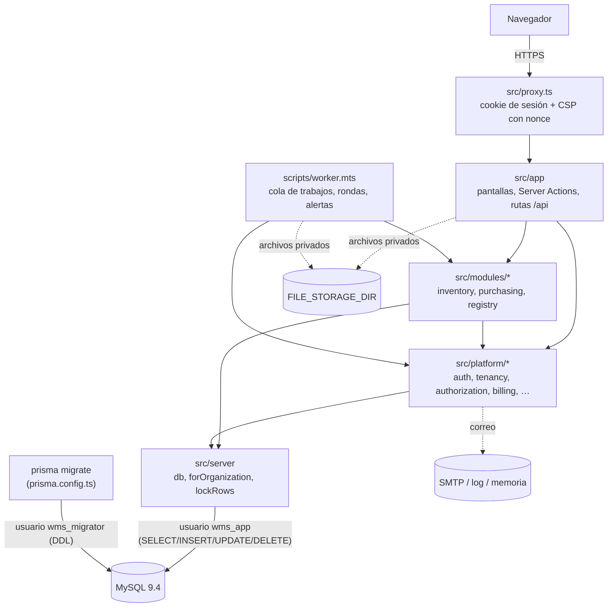

# Arquitectura del WMS

Documentación técnica base (WMS-51). Describe el código tal como está en la
rama `pruebas`; cuando algo de aquí contradiga el código, manda el código y se
corrige este documento. Las reglas de trabajo están en `AGENTS.md` y las
decisiones, en `docs/adr/`.

| Documento | Qué tiene |
| --- | --- |
| Este archivo | Capas, qué importa a qué, petición, multiempresa, permisos, alcance, worker y base de datos |
| [modelo-de-datos.md](modelo-de-datos.md) | Cada tabla por área (generado del esquema: `node scripts/data-model.mjs`) |
| [candados.md](candados.md) | Orden de candados, `lockRows` siempre por la llave primaria y la puerta a los almacenes (WMS-76) |
| [modulos/](modulos/) | Un documento por módulo y por área de plataforma |
| [modulos/approvals.md](modulos/approvals.md) | Motor de aprobaciones: reglas por empresa, solicitudes, decidir (WMS-56) |
| [modulos/notifications.md](modulos/notifications.md) | Avisos dentro de la app: `notify` en la transacción del hecho, campana, preferencias (WMS-39) |
| [modulos/terminals.md](modulos/terminals.md) | Terminales compartidas con PIN: registrar dispositivos, PIN de cada persona, sesión corta y recortada (WMS-38) |
| [modulos/api.md](modulos/api.md) | API REST por empresa con llaves recortadas, límites, OpenAPI y webhooks firmados (WMS-60) |
| [modulos/automations.md](modulos/automations.md) | Automatizaciones: reglas «cuando pasa algo, si…, hacer esto» por empresa, ejecutadas por el worker a nombre de una persona (WMS-64) |
| [modulos/custom-fields.md](modulos/custom-fields.md) | Campos personalizados de productos, ubicaciones y proveedores: definir, validar y guardar valores (WMS-58) |
| [agregar-un-modulo.md](agregar-un-modulo.md) | Paso a paso para agregar un módulo nuevo |
| [`CHANGELOG.md`](../../CHANGELOG.md) | Registro de cambios por paso cerrado |

## Piezas

Una sola aplicación Next.js (App Router, Server Components y Server Actions)
más un proceso aparte, el worker, que corre el mismo código de servidor. Los
dos hablan con una base MySQL 9.4 por Prisma. No hay otros servicios.



## Capas y qué importa a qué

```text
src/
  app/          Rutas y pantallas: (app) la aplicación, (auth) cuentas, (sitio) sitio
                público, interno la consola de plataforma, api rutas GET de descarga.
  components/   Componentes visuales compartidos (shadcn/ui en components/ui, AppShell,
                estados de pantalla, nav.ts con el menú).
  lib/          Utilidades sin reglas de negocio (errores, ids, decimales, fechas, log, CSP,
                app instalable).
  server/       Infraestructura: cliente Prisma (db), cliente por empresa
                (forOrganization), candados (lockRows), LOCKING_TRANSACTION.
  platform/*    Núcleo compartido por todos los módulos (ver modulos/).
  modules/*     Módulos contratables: inventory (la base), purchasing, production
                (recetas, WMS-27); quality anunciado (WMS-59); registry los reúne.
```

| Desde | Puede importar |
| --- | --- |
| `app` | `modules`, `platform` y `lib` solo por su `index.ts`; `components` |
| `modules/*` | otros módulos, `platform` y `lib` solo por su `index.ts`; `server`; `components` |
| `platform/*` | otra área de `platform` y `lib` solo por su `index.ts`; `server`. **Nunca** módulos |
| `server`, `components` | `lib` (`index.ts`) |

Lo impone `eslint-plugin-boundaries` (`eslint.config.mjs`) y lo demuestra
`npm run lint:boundaries` (`scripts/verify-boundaries.mjs`, con archivos
temporales). Una segunda regla de ESLint prohíbe importar `db` desde
`src/modules/**` y desde `platform/{catalog,contacts,files,locations}`: el
código de negocio solo llega a la base por `forOrganization`.

Como la plataforma no puede importar módulos, todo lo que la plataforma
necesita saber de ellos se lo pasa `src/modules/registry` como datos: los
contratos (`moduleRegistry`), los manejadores de trabajos (`jobHandlers`), las
rondas (`scheduledRounds`), los ajustes (`operationSettings`), los tipos de
aprobación con su efecto (`approvalTypes`, WMS-56), los eventos de webhooks
(`webhookEventTypes`, WMS-60) y el trabajo a medias de
cada módulo (`moduleOpenWork`).

## Cómo viaja una petición

Ejemplo: liberar un pedido de salida.

1. `src/proxy.ts` revisa que haya cookie de sesión en las rutas protegidas
   (lista `PROTECTED`; solo es optimista) y pone la política de scripts con un
   nonce por petición.
2. La pantalla (`src/app/(app)/pedidos/[id]/page.tsx`, Server Component)
   empieza con `getModuleAccess()`: sesión, empresa activa, roles leídos de la
   base y módulos contratados. Si `!access.can("inventory.outbound.read")`
   muestra `NoAccessState`; si el módulo no está, `NoModuleState`; en solo
   lectura, `ReadOnlyNotice` y sin botones de escritura.
3. El componente cliente envía un formulario a una Server Action
   (`src/app/(app)/pedidos/actions.ts`, `"use server"`) con `useActionState`.
   La acción solo traduce `FormData` ↔ servicio: toma persona y empresa de
   `requireOrganizationContext()` (nunca del formulario), llama al servicio y
   hace `revalidatePath`/`redirect`.
4. El servicio (`releaseOutboundOrder` de `src/modules/inventory`) vuelve a
   comprobar el permiso y el módulo con `assertModulePermission`, valida con
   Zod y devuelve una unión de resultado (`{ ok: true } | { ok: false, … }`)
   para los fallos esperados; lanza `AppError` solo ante lo inesperado.
5. Dentro, una transacción de `forOrganization(organizationId).$transaction(…,
   LOCKING_TRANSACTION)`: primero los candados (`lockRows`, orden fijo:
   productos → almacén → ubicaciones → documento → tarea, ver
   [candados.md](candados.md)), después leer, decidir y
   escribir (saldo, movimiento, reserva, bitácora) en la misma transacción.

**La API (WMS-60, ADR 0058).** `/api/v1/*` no usa la cookie de sesión: el
motor de `platform/api` toma la llave de `Authorization: Bearer`, aplica los
límites y llama a los mismos servicios dentro de `runDelegated`, que hace
que la llave actúe por quien la creó, recortada a sus capacidades y a su
almacén (`Subject.limit` en `policy.ts`). Ver
[modulos/api.md](modulos/api.md).

Las descargas (CSV, XLSX, PDF) no pasan por Server Actions: son rutas `GET`
bajo `src/app/api/…` que llaman `requireOrganizationContext()` y responden
`attachment` + `nosniff` + `no-store`.

**App instalable y cámara (WMS-35/36, ADR 0049).** El manifiesto
(`src/app/manifest.ts`), los íconos (`public/icons`, `src/app/apple-icon.png`,
`scripts/pwa-icons.mjs`), el service worker (`/sw.js`) y la página sin
conexión (`/sin-conexion`) son públicos y salen de `src/lib/pwa.ts`. El
worker solo guarda su página sin conexión y solo responde cuando una
navegación `GET` falla por red: nunca guarda pantallas, `/api` ni nada de una
sesión, y no toca Server Actions ni peticiones de datos de Next. Lo registra
`PwaSetup` (`src/components/pwa-setup.tsx`, montado en el layout raíz) desde
el paquete de la app, sin script en línea.
`OfflineNotice` (en `AppShell`) avisa cuando el navegador pierde la red. La
cámara es `CameraScanButton` (`src/components/camera-scan.tsx`): con
`BarcodeDetector` teclea lo leído en el campo de siempre, con su Enter, así
que la pantalla y el servidor no distinguen la cámara de un lector.

**JavaScript compartido (WMS-86, ADR 0080).** Lo que importa el layout raíz
llega a todas las páginas, también al sitio público: solo monta
`THEME_SCRIPT` y `PwaSetup` (`pwa-setup.tsx`). Los componentes se importan por
su archivo (`@/components/states`, `@/components/form-field`…): no hay índice
`@/components`, porque un componente de servidor que lo importaba metía en su
página todos los componentes de cliente que exportaba. Los avisos de Sonner
(`Toasts`, `src/components/providers.tsx`) los montan los layouts de la app,
de las cuentas y de `/sistema-visual`, fuera del `<main>`. `motion` no tiene proveedor global: cada componente que lo
usa (`FadeIn`, `WarehouseScene`, sesiones activas) lleva su
`MotionConfig reducedMotion="user"`; la barra lateral, el interruptor de tema y
la tarjeta de las cuentas animan con CSS; el servidor dibuja la ilustración
quieta (`WarehouseSceneStill`, sin `motion`) en el sitio y en las cuentas, donde
`AccountScene` la cambia por la animada solo en pantallas anchas. Nada de lo
que el marco necesita para moverse y salir («Más», «Cerrar sesión», cambiar de
empresa o almacén, avisos) se descarga a pedido: una falla de red no lo deja
sin abrir.

## Multiempresa

- Toda tabla de negocio lleva `organizationId`, con relaciones compuestas
  (`[organizationId, xId] → [organizationId, id]`) y `@@unique([organizationId,
  id])`; así la base rechaza una fila que apunte a otra empresa.
- Esas tablas se listan en `TENANT_MODELS` (`src/server/tenant-db.ts`);
  `src/server/tenant-db.test.ts` falla si una tabla con la columna falta en la
  lista o rompe las reglas de llaves.
- `forOrganization(id)` agrega la empresa a cada filtro, comprueba cada alta,
  rechaza mover filas de empresa y prohíbe SQL directo. La única excepción es
  `lockRows(tx, modelo, ids)`, que hace `SELECT … FOR UPDATE` con el filtro de
  empresa, siempre por la llave primaria y en orden de id (orden de
  candados en [candados.md](candados.md), ADR 0074).
- La empresa activa vive en la sesión (`session.activeOrganizationId`) y
  `requireOrganizationContext()` la revalida contra una membresía activa en
  cada petición. Un trabajo del worker recibe la empresa de su fila, nunca del
  `payload`.
- `tests/isolation/two-companies.int.test.ts` crea datos en todas las tablas de
  empresa de dos empresas y comprueba que una no ve a la otra.

## Permisos, módulo y alcance

Una operación de un módulo pasa, en orden, por:

```text
sesión → membresía activa → el rol concede el permiso → la empresa tiene el módulo
       → (si escribe) el módulo no está en solo lectura → (si suma) el cupo alcanza
       → (si toca una ubicación) la ubicación está en el alcance de la persona
```

- **Permisos**: identificadores `modulo.recurso.accion` en
  `src/platform/authorization/catalog.ts`, igual que la matriz aprobada
  `docs/MATRIZ_ROLES_PERMISOS.md` (`catalog.test.ts` las compara). Los
  `platform.*` son del núcleo; los demás pertenecen al módulo de su prefijo.
  Decisión única: `can(subject, permiso, lugar?)` de `policy.ts` (pura,
  denegar por defecto). Titular = `Organization.ownerUserId` con
  `OWNER_PERMISSIONS`; no es un rol.
- **Módulo**: `assertModulePermission` / `getModuleAccess` de
  `platform/billing` (`guard.ts`) agregan si la empresa tiene el módulo según
  `entitlement`. Un permiso que no termina en `.read`/`.export` (o
  `*.export.create`) se trata como escritura y se niega con el plan vencido.
- **Alcance** (ADR 0038): `membership_scope` limita a una persona a almacenes y
  zonas. Viaja en el sujeto (`Subject.scope`) y lo deciden la política y los
  ayudantes de `platform/locations` (`assertLocationsInScope`,
  `locationScopeWhere`, `isFacilityInScope`, `assertWholeFacilityInScope`).
  Las cifras de toda la empresa solo las ve quien no tiene límite
  (`seesWholeCompany`).
- Validar en los dos lados: la pantalla pinta solo lo permitido y el servicio
  lo vuelve a comprobar.

## Worker y cola de trabajos

`scripts/worker.mts` (`npm run worker`) es un proceso aparte que importa el
mismo código de servidor. Hace cuatro cosas:

| Qué | Dónde | Cada cuánto |
| --- | --- | --- |
| Corre trabajos de la cola, uno a la vez por worker (pueden correr varios) | `runWorker(jobHandlers)` de `platform/jobs` | continuo |
| Cierra trabajos que fallaron en definitiva (`onFailed` devuelve lo apartado) | `settleFailedJobs` | cada 30 s y tras cada fallo |
| Rondas programadas de los módulos, empresa por empresa | `runScheduledRounds(scheduledRounds)` | cada hora (hoy, la reposición de surtido de Inventario, WMS-24) |
| Latido para `/api/salud` y alertas operativas por correo | `writeWorkerHeartbeat`, `runAlertRound` de `platform/ops` | 15 s y 1 min |

Un trabajo es una fila de `job` (ADR 0013): se encola con `enqueueJob(tx,
organizationId, …)` dentro de la transacción del cambio que lo origina, corre
al menos una vez (el manejador debe ser idempotente; `context.jobId` sirve de
clave), reintenta con espera creciente hasta `maxAttempts` y trabaja solo con
`forOrganization(context.organizationId)`. Tipos actuales:
`inventory.import_products`, `inventory.import_exits`,
`purchasing.send_order`, `platform.webhook_fanout` y `platform.webhook_delivery` (WMS-60).

## Base de datos

- MySQL 9.4 con Prisma 7.10 y `@prisma/adapter-mariadb`; esquema en
  `prisma/schema.prisma`, cliente generado en `src/server/generated/`.
- Dos usuarios: **`wms_app`** (solo `SELECT/INSERT/UPDATE/DELETE`, lo usa la
  aplicación y el worker en `src/server/db.ts`) y **`wms_migrator`** (DDL, lo
  usa la CLI de Prisma por `prisma.config.ts`). `root` solo crea bases y
  usuarios (`npm run db:setup`). Así la aplicación no puede cambiar el esquema
  ni quitar disparadores.
- Bases: `wms_dev`, `wms_test` (las pruebas de integración la migran y vacían),
  `wms_shadow`.
- Reglas en la base además de Prisma: `CHECK`, disparadores de inmutabilidad
  (movimientos, recepciones, bitácora), tablas de transición de estados
  repetidas en disparadores. Viven en `prisma/migrations/`.
- Migraciones solo de expansión: nada que borre o renombre algo que la versión
  anterior use. Una migración aplicada no se edita: se agrega otra.
- IDs UUIDv7 (`newId`), fechas `DATETIME(3)` en UTC, cantidades y dinero con
  `Decimal`.
- Existencias: el saldo (`stock_balance`) solo cambia junto con un movimiento
  inmutable en la misma transacción; `npm run stock:reconcile` compara saldos e
  historial (ADR 0012, 0033).

## Pruebas

`npm test` corre dos proyectos de Vitest: `unit` (`src/**/*.test.ts`, código
puro) e `integration` (`*.int.test.ts` en `src/` y `tests/`, un archivo a la vez
contra `wms_test`). Varias pruebas existen para que olvidar un paso falle; las
que tocan a quien agrega algo están en
[agregar-un-modulo.md](agregar-un-modulo.md#pruebas-que-fallan-si-falta-algo).
`npm run check` = tipos, ESLint, límites, Prettier y pruebas.
